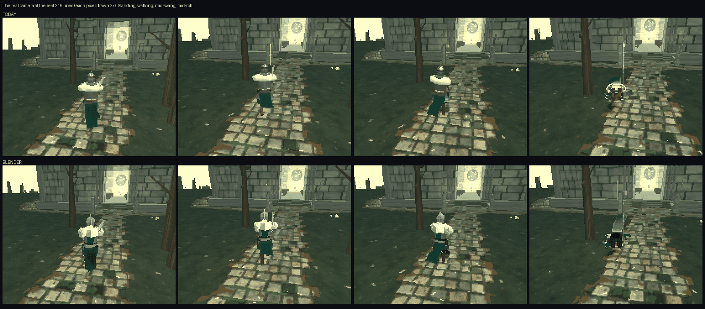
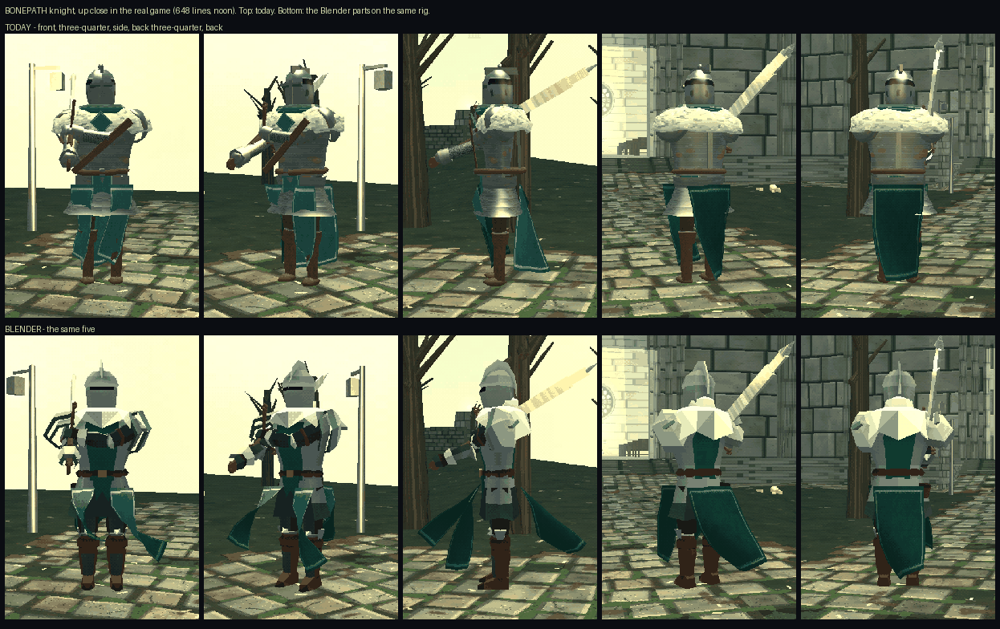
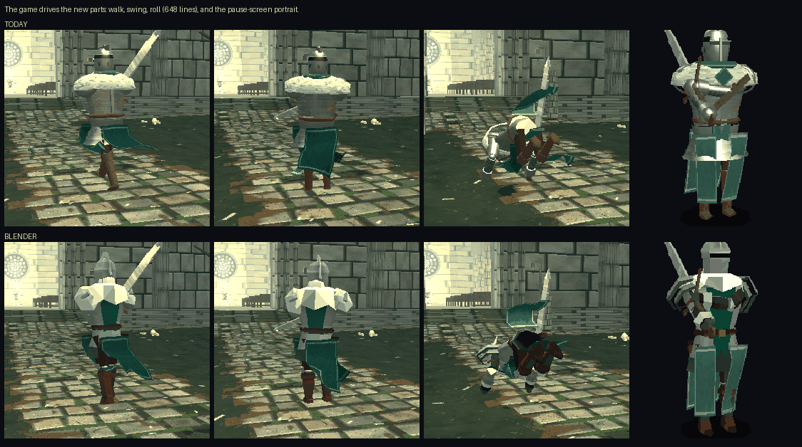
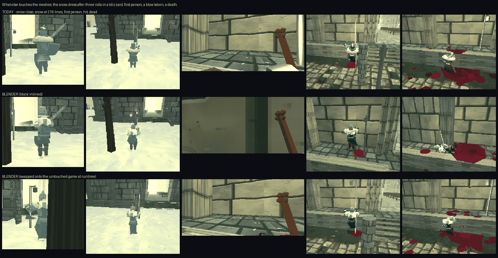
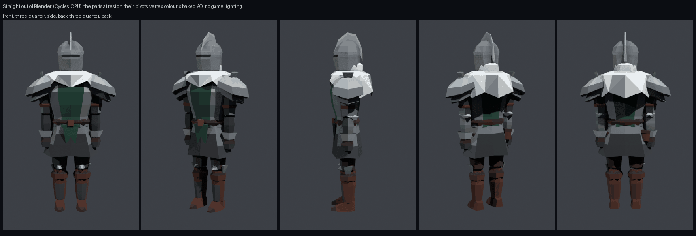

# A Blender pipeline for BONEPATH — the knight as a trial

**In one sentence:** the hero's body was rebuilt in Blender as thirteen
hard-edged parts, turned into ten kilobytes of text, and worn by the game's
existing skeleton — and the game walked, swung, rolled, took a blow, went
first-person, wore snow, died and rose with it, with no errors, without
`index.html` being changed.

Nothing is in the game yet. This is the proof and the plan.

## The pictures

**At the real camera, at the real 216 lines** — how the hero is actually seen
(each game pixel drawn twice as large). Top row today, bottom row the Blender
parts:



**Up close** (648 lines, the game's own sharper picture setting), front to back:



**The game moving it** — walk, swing, roll, and the pause-screen portrait:



**The other systems** — snow dress, first person, a blow, a death; the third
row is the untouched game with the parts swapped in while it ran:



**Straight out of Blender**, before the game lights it:



## What improved

- **It reads as a character someone modelled**, not as lathed shapes and
  spheres stacked up. The helm is a sallet with a keel down the face, one dark
  slit, a proud brow and a tall comb; the shoulders are stepped plates with a
  fin; the elbows and knees have points; the boots have a turned top and a toe.
  This shows most in the pause portrait and up close from behind.
- **Hard facets everywhere.** Today's cuirass, helm and pauldrons are
  smooth-shaded lathes — the least PS1 thing on him. Every face of the new one
  is flat.
- **Shading is baked in.** Ambient occlusion is in the vertex colours, so the
  under-side of the pauldrons, the neck, the belt line and the boots sit darker
  whatever the hour. Today's knight has none.
- **It is much cheaper to draw.** 49 separate meshes become 13; 2,702
  triangles become 1,346.

## What still looks off — plainly

- **At the real camera distance it is not clearly better. It is different,
  and about level.** The hero is roughly 45 pixels tall there. The comb on the
  helm and the paler, squarer shoulders read well. But today's wide white fur
  collar is a stronger single shape than the new torn one, and today's steel
  has a moving glint the new one cannot have. If the only test is the picture
  at that size, this is a draw, not a win.
- **From the front it is busier and darker than today's.** In the carry pose
  the arms cross the chest; the dark mail on the inside of the arms and the
  undersides of the pauldrons make a tangle where today's has clean bright
  steel and a leather strap.
- **No glint.** Today's iron, helm and mail use a shiny material; the new
  parts share one matte material so that everything is one colour-per-vertex
  mesh. Plate looks like painted plate. A PlayStation would not have had the
  glint either, but it is a visible loss next to today's.
- **Flat colour where today has texture.** The fur was a noisy white pelt and
  the mail a woven pattern; both are now plain facets.
- **The roll shows the dark underside of the skirt**, a black patch for a few
  frames.
- **The thigh takes no boot-snow** (the game decides by where a mesh's origin
  is, and a thigh's origin is now the hip). Small, fixable.
- The model went through three rounds (colours and shadow strength; the
  torso's facets, back and pauldrons; shoulder width, leg thickness and
  boots). It wants an artist's eye for a fourth.

## What it costs

| | today | with the Blender knight |
|---|---|---|
| meshes on the hero's body (draw calls) | 49 | **13** |
| triangles on the body | 2,702 | **1,346** |
| materials on the body | 30-odd, 9 textures | 1, no texture |
| the whole hero rig incl. sword, cloth, shadow | 77 draws | 41 draws |
| added to `index.html` | — | **13,220 bytes** (+0.6 %), about 8 kB gzipped |
| work at boot | builds ~50 primitives | decodes 8 strings, under a millisecond's worth of loops |
| runtime files | none | none |

Draw calls per rig go **down by 36**; they cannot rise, because each joint
gets exactly one mesh (two on the shoulders). Frame rate was not measured:
this ran on a software renderer in a headless browser, which says nothing
about a phone.

## What was checked, and what was not

Checked, in the real game, for 20 seconds each, twice (block inlined into an
in-memory copy; and parts swapped onto the untouched game at runtime): walk,
three swings, a roll, a blow taken, first person and back, the pause portrait,
death. **Zero page errors, zero broken joints.** Snow dress in a blizzard:
works. `tools/check parse boot codex` on the patched copy: all passed (four
modes boot, 78 codex entries).

Not checked: a real phone, Safari, frame rate; any weapon but the claymore;
the other four armours (they are untouched by design); limb-severing, the
home-run and bat-shatter finishers; the long path walks and the leak check.
The distant-body swap (LOD) never applies to the hero, so it was not tested —
it will matter for horrors.

One thing found on the way: `docs/HERO_MODEL_BRIEF.md` says the hero is
1.95 m tall with hips at 1.06 m. The rig in the game measures 2.14 m to the
crown (2.20 to the knob) with hips at 1.04 m. The brief should be corrected
before it is sent to anyone.

## To put it in the game for real

1. **Where it lives.** A generated section just above `makeKnightRig`:
   `decode.js` (48 lines) and `const BP_KNIGHT={...};` (one line, 10 kB),
   between two marker comments so a script can replace it. One line at the end
   of `makeKnightRig`:
   `if(r.loadout.armour==='knight')bpDress(r,BP_KNIGHT,()=>flatMat(0xffffff));`
   This is the same move `sheetDress` already makes for the sheet knight:
   strip the primitives, hang the hulls, touch no joint. An entry in the
   CONTENTS comment.
2. **A stamping script** (not written yet) that writes the block between the
   markers, so nobody pastes by hand. `pages.yml` is not touched.
3. **Decide the glint.** Either accept matte plate, or split plate and cloth
   into two meshes per part (26 draws, still half of today's) with the shiny
   material on the plate.
4. **Lines for `CLAUDE.md`:**
   - under *The aesthetic*: "Models built in Blender arrive as an INLINED,
     generated block (`BP_KNIGHT`), decoded by `bpDecode`. It is not an asset
     file and is never edited by hand: change `tools/blender/build_*.py` and
     re-run. No loader, no glTF at runtime, no skinning."
   - under *Performance*: "A Blender part is one mesh per joint and one shared
     `flatMat`; do not split a part without a reason (the pauldron is split
     because `fpsMaskRig` masks arm meshes one by one)."
   - under *Snow and marks*: "`dressSnow` reads a mesh's ORIGIN for its share;
     a Blender part's origin is its joint."
   - under *Testing*: the command below.
5. **Run all of `tools/check`**, then look at it on a phone.

## The plan

1. **Hero first.** A fourth art pass with the owner's eye on the real-camera
   sheet (broader collar, cleaner front), the glint decision, then steps 1–5
   above. The old knight stays one flag away (`?oldknight` in the trial) until
   it is agreed.
2. **Then the hollow** — the commonest horror, and the real saving: a hollow is
   41 meshes and there are dozens on screen. New things to solve there, none of
   them hard: hollows are built at random scales (decode once, scale the
   mesh — do not decode per size); the far-body stand-in takes its colour from
   the biggest mesh's material, which would now be white; limbs are severed and
   skeletons scatter by joint, which a one-mesh-per-joint part suits well; the
   jaw and eyes stay separate. The codex needs no new entry — same horror.
3. **Then the bosses**, one at a time, starting with the Warden (the same
   skeleton at twice the size). The Fallen One, the Rider's horse and the
   Bell-Called have their own rigs and their own rules and each wants its own
   measuring first.

## Re-running everything

```sh
sh tools/blender/run.sh
```

About six minutes: installs Blender-as-a-Python-module on first use (outside
the repository), rebuilds the model and the block, photographs both knights in
the real game, plays each, and rewrites the five sheets here. To play it
yourself: `node tools/blender/serve.js` and open the address it prints.
Technical detail: `tools/blender/README.md`.
